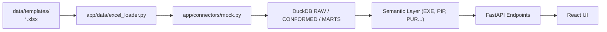

# Data Templates & Sample Datasets

This directory contains standardized master data input templates and sample datasets for the **Moment GTM Dashboard**.

---

## Files

### `Moment_GTM_Dashboard_Master_Data_Template.xlsx`
- **Purpose:** The master multi-tab spreadsheet used by leadership, sales operations, and solution architects to input enterprise pipeline, account, and financial figures into the dashboard.
- **Generator:** Rebuilt on demand with `python scripts/build_all_modules_excel_template.py`.
- **Ingestion Engine:** Parsed directly by `backend/app/data/excel_loader.py` during ELT execution to populate DuckDB tables.
- **Fallback:** Sheets with no data rows (header only) are ignored, and the synthetic dataset (`app/data/generator.py`) is used for those tables. A backup of the previously populated template is kept as `Moment_GTM_Dashboard_Master_Data_Template.backup.xlsx`.
- **Reference Guide:** For complete field definitions, data dictionaries, screen-flow mappings, and sample values, see [docs/guides/Moment_GTM_Dashboard_Data_Input_and_Screen_Flow_Guide.md](../../docs/guides/Moment_GTM_Dashboard_Data_Input_and_Screen_Flow_Guide.md).

---

## Ingestion Architecture

