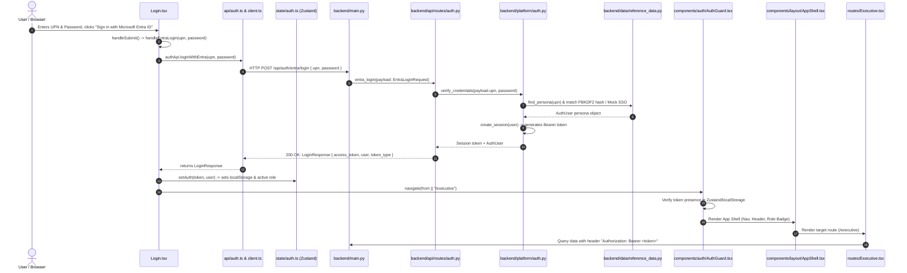

# Moment GTM Dashboard - End-to-End Login Process Flow & Architecture Reference

This document provides a comprehensive end-to-end breakdown of the authentication and authorization flow initiated when a user submits credentials in [`Login.tsx`](file:///C:/Users/299454/OneDrive%20-%20Cognizant/LTIN144644_Backup/Moment-GTM/Workspace/dashboard/frontend/src/routes/Login.tsx).

---

## 1. High-Level Flow Diagram



---

## 2. Detailed Step-by-Step Execution Journey

### Step 1: User Submission on the Frontend
* **Source:** [`frontend/src/routes/Login.tsx`](file:///C:/Users/299454/OneDrive%20-%20Cognizant/LTIN144644_Backup/Moment-GTM/Workspace/dashboard/frontend/src/routes/Login.tsx)
* **Action:**
  1. User fills in corporate User Principal Name (`upn`) and optional password (`password`).
  2. Clicking "Sign in with Microsoft Entra ID" triggers `handleSubmit(e: React.FormEvent)`.
  3. Form event default behavior is prevented (`e.preventDefault()`), and `handleEntraLogin(upn, password)` is called.
  4. Local state updates: `setLoading(true)` and `setError(null)`.

### Step 2: API Client Request
* **Source:** [`frontend/src/api/auth.ts`](file:///C:/Users/299454/OneDrive%20-%20Cognizant/LTIN144644_Backup/Moment-GTM/Workspace/dashboard/frontend/src/api/auth.ts) and [`frontend/src/api/client.ts`](file:///C:/Users/299454/OneDrive%20-%20Cognizant/LTIN144644_Backup/Moment-GTM/Workspace/dashboard/frontend/src/api/client.ts)
* **Action:**
  1. `authApi.loginWithEntra(upn, password)` constructs the request payload:
     ```json
     {
       "upn": "jordan.avery@moment.example",
       "password": "Moment#2026$Jordan!GTM"
     }
     ```
  2. Dispatches `POST` request to `/api/auth/entra/login` via `api.post(...)`.

### Step 3: Backend FastAPI Ingestion & Routing
* **Source:** [`backend/app/main.py`](file:///C:/Users/299454/OneDrive%20-%20Cognizant/LTIN144644_Backup/Moment-GTM/Workspace/dashboard/backend/app/main.py) and [`backend/app/api/routes/auth.py`](file:///C:/Users/299454/OneDrive%20-%20Cognizant/LTIN144644_Backup/Moment-GTM/Workspace/dashboard/backend/app/api/routes/auth.py)
* **Action:**
  1. FastAPI handles incoming request, validates CORS policies, and routes request to `entra_login(payload: EntraLoginRequest)`.
  2. Sanitizes input and passes `upn` and `clean_pwd` to the platform auth service.

### Step 4: Persona Verification, Credential Hashing & Session Creation
* **Source:** [`backend/app/platform/auth.py`](file:///C:/Users/299454/OneDrive%20-%20Cognizant/LTIN144644_Backup/Moment-GTM/Workspace/dashboard/backend/app/platform/auth.py) and [`backend/app/data/reference_data.py`](file:///C:/Users/299454/OneDrive%20-%20Cognizant/LTIN144644_Backup/Moment-GTM/Workspace/dashboard/backend/app/data/reference_data.py)
* **Action:**
  1. `find_persona(login_id)` searches `ENTRA_PERSONAS` by UPN, username, or role.
  2. `verify_credentials(login_id, password)`:
     - If password is provided: calculates `hashlib.pbkdf2_hmac("sha256", password, salt, 100_000)` and validates using constant-time `secrets.compare_digest`.
     - In mock SSO mode (`GTM_AUTH_MODE=mock_entra`): accepts valid UPNs directly.
  3. `create_session(user)`:
     - Generates cryptographically secure 32-byte URL-safe token: `secrets.token_urlsafe(32)`.
     - Stores session in memory with a 24-hour TTL: `_SESSIONS[token] = (user.upn, expiry)`.
  4. Returns `LoginResponse` containing:
     ```json
     {
       "access_token": "wK...session_token...",
       "token_type": "bearer",
       "user": {
         "username": "jordan.avery",
         "upn": "jordan.avery@moment.example",
         "name": "Jordan Avery",
         "email": "jordan.avery@moment.example",
         "role": "business_owner",
         "role_label": "Business Owner",
         "job_title": "Business Owner",
         "group_name": "Executive Leadership",
         "scope_type": "all",
         "scope_value": null,
         "description": "Full Enterprise visibility across all 8 modules + Admin Console (Business Owner)"
       }
     }
     ```

### Step 5: Frontend State Storage & Session Persistence
* **Source:** [`frontend/src/state/auth.ts`](file:///C:/Users/299454/OneDrive%20-%20Cognizant/LTIN144644_Backup/Moment-GTM/Workspace/dashboard/frontend/src/state/auth.ts) and [`frontend/src/state/role.ts`](file:///C:/Users/299454/OneDrive%20-%20Cognizant/LTIN144644_Backup/Moment-GTM/Workspace/dashboard/frontend/src/state/role.ts)
* **Action:**
  1. `setAuth(res.access_token, res.user)` stores token and user in Zustand state.
  2. Syncs user role to `useRoleStore.getState().setRole(user.role)`.
  3. Zustand `persist` middleware writes state to browser `localStorage` key `gtm-auth`.

### Step 6: Route Navigation & Guard Verification
* **Source:** [`frontend/src/components/auth/AuthGuard.tsx`](file:///C:/Users/299454/OneDrive%20-%20Cognizant/LTIN144644_Backup/Moment-GTM/Workspace/dashboard/frontend/src/components/auth/AuthGuard.tsx) and [`frontend/src/App.tsx`](file:///C:/Users/299454/OneDrive%20-%20Cognizant/LTIN144644_Backup/Moment-GTM/Workspace/dashboard/frontend/src/App.tsx)
* **Action:**
  1. `Login.tsx` executes `navigate(from, { replace: true })` (redirects to `/executive` or originally intercepted URL).
  2. `AuthGuard` checks `useAuthStore((s) => s.token)`. Finding a valid token, it mounts `<Outlet />`.
  3. [`AppShell.tsx`](file:///C:/Users/299454/OneDrive%20-%20Cognizant/LTIN144644_Backup/Moment-GTM/Workspace/dashboard/frontend/src/components/layout/AppShell.tsx) loads navigation menus, active role badges, and the target route (e.g., [`Executive.tsx`](file:///C:/Users/299454/OneDrive%20-%20Cognizant/LTIN144644_Backup/Moment-GTM/Workspace/dashboard/frontend/src/routes/Executive.tsx)).

### Step 7: Downstream Data Fetching with RLS and Audit Logs
* **Source:** [`frontend/src/api/client.ts`](file:///C:/Users/299454/OneDrive%20-%20Cognizant/LTIN144644_Backup/Moment-GTM/Workspace/dashboard/frontend/src/api/client.ts), [`backend/app/api/deps.py`](file:///C:/Users/299454/OneDrive%20-%20Cognizant/LTIN144644_Backup/Moment-GTM/Workspace/dashboard/backend/app/api/deps.py), [`backend/app/semantic/rls.py`](file:///C:/Users/299454/OneDrive%20-%20Cognizant/LTIN144644_Backup/Moment-GTM/Workspace/dashboard/backend/app/semantic/rls.py), [`backend/app/platform/audit.py`](file:///C:/Users/299454/OneDrive%20-%20Cognizant/LTIN144644_Backup/Moment-GTM/Workspace/dashboard/backend/app/platform/audit.py)
* **Action:**
  1. All subsequent React Query fetch requests include:
     - `Authorization: Bearer <token>`
     - `X-Mock-Role: <role>` (ignored by the backend whenever a valid Bearer token is present; only honoured without a token in mock mode with `GTM_ALLOW_MOCK_IDENTITY=1`)
  2. `deps.current_user` extracts the token, queries `get_user_from_token(token)`, and resolves user permissions.
  3. `deps.require_module("executive")` checks module access permissions (HTTP 403 if unauthorized).
  4. Restricted metrics (PUR-06, CAP-03) trigger `guard_restricted(...)` and write access logs to DuckDB audit store via `get_audit().record(...)`.
  5. Semantic queries apply Row-Level Security (RLS) filters based on user role and scope values (Practice / Partner / Account).

---

## 3. File Navigation & Module Architecture

### Frontend Module (`frontend/src/`)
| File Path | Description / Responsibility |
| :--- | :--- |
| [`routes/Login.tsx`](file:///C:/Users/299454/OneDrive%20-%20Cognizant/LTIN144644_Backup/Moment-GTM/Workspace/dashboard/frontend/src/routes/Login.tsx) | Microsoft Entra login form UI, input validation, submission handler, loading states. |
| [`api/auth.ts`](file:///C:/Users/299454/OneDrive%20-%20Cognizant/LTIN144644_Backup/Moment-GTM/Workspace/dashboard/frontend/src/api/auth.ts) | Authentication API client methods: `loginWithEntra`, `login`, `getPersonas`, `me`, `logout`. |
| [`api/client.ts`](file:///C:/Users/299454/OneDrive%20-%20Cognizant/LTIN144644_Backup/Moment-GTM/Workspace/dashboard/frontend/src/api/client.ts) | Fetch wrapper attaching `Authorization: Bearer <token>`, role headers, error formatting. |
| [`state/auth.ts`](file:///C:/Users/299454/OneDrive%20-%20Cognizant/LTIN144644_Backup/Moment-GTM/Workspace/dashboard/frontend/src/state/auth.ts) | Zustand auth store with localStorage persistence (`gtm-auth`), `setAuth`, and `clearAuth`. |
| [`state/role.ts`](file:///C:/Users/299454/OneDrive%20-%20Cognizant/LTIN144644_Backup/Moment-GTM/Workspace/dashboard/frontend/src/state/role.ts) | Active role state synced with the authenticated user persona. |
| [`components/auth/AuthGuard.tsx`](file:///C:/Users/299454/OneDrive%20-%20Cognizant/LTIN144644_Backup/Moment-GTM/Workspace/dashboard/frontend/src/components/auth/AuthGuard.tsx) | Route guard preventing unauthenticated access; redirects to `/login`. |
| [`components/layout/AppShell.tsx`](file:///C:/Users/299454/OneDrive%20-%20Cognizant/LTIN144644_Backup/Moment-GTM/Workspace/dashboard/frontend/src/components/layout/AppShell.tsx) | Global layout wrapper containing header, sidebar navigation, and user identity profile. |
| [`App.tsx`](file:///C:/Users/299454/OneDrive%20-%20Cognizant/LTIN144644_Backup/Moment-GTM/Workspace/dashboard/frontend/src/App.tsx) | Application root routing tree defining public vs guarded routes. |

### Backend Module (`backend/app/`)
| File Path | Description / Responsibility |
| :--- | :--- |
| [`main.py`](file:///C:/Users/299454/OneDrive%20-%20Cognizant/LTIN144644_Backup/Moment-GTM/Workspace/dashboard/backend/app/main.py) | FastAPI application entry point, CORS middleware, router registration, lifespan startup. |
| [`api/routes/auth.py`](file:///C:/Users/299454/OneDrive%20-%20Cognizant/LTIN144644_Backup/Moment-GTM/Workspace/dashboard/backend/app/api/routes/auth.py) | Endpoints for `/api/auth/entra/login`, `/api/auth/entra/personas`, `/api/auth/me`, `/logout`. |
| [`platform/auth.py`](file:///C:/Users/299454/OneDrive%20-%20Cognizant/LTIN144644_Backup/Moment-GTM/Workspace/dashboard/backend/app/platform/auth.py) | Credential verification, PBKDF2 hashing, session store `_SESSIONS`, bearer token creation. |
| [`data/reference_data.py`](file:///C:/Users/299454/OneDrive%20-%20Cognizant/LTIN144644_Backup/Moment-GTM/Workspace/dashboard/backend/app/data/reference_data.py) | Reference personas (`PERSONA_USERS`), role definitions, and default access scopes. |
| [`api/deps.py`](file:///C:/Users/299454/OneDrive%20-%20Cognizant/LTIN144644_Backup/Moment-GTM/Workspace/dashboard/backend/app/api/deps.py) | Dependency injection for `current_user`, `require_module(...)`, `guard_restricted(...)`. |
| [`semantic/rls.py`](file:///C:/Users/299454/OneDrive%20-%20Cognizant/LTIN144644_Backup/Moment-GTM/Workspace/dashboard/backend/app/semantic/rls.py) | Row-Level Security evaluation and SQL filtering based on user role and persona scope. |
| [`platform/audit.py`](file:///C:/Users/299454/OneDrive%20-%20Cognizant/LTIN144644_Backup/Moment-GTM/Workspace/dashboard/backend/app/platform/audit.py) | Audit trail engine logging restricted metric access and security violations (NFR-07). |
