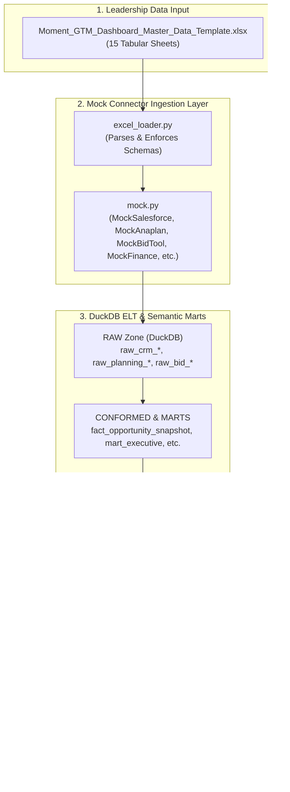
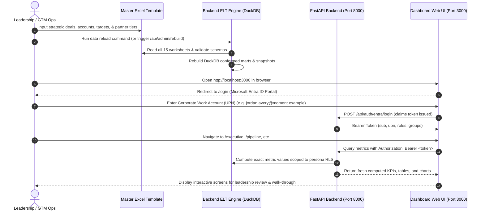

# Moment GTM Dashboard — Master Data Input & Screen Flow Validation Guide

> **Executive Summary:** This document establishes the master operational framework and field-by-field mapping for feeding user-defined corporate data into all **8 dashboard modules** of the **Moment GTM Dashboard**. By populating `data/templates/Moment_GTM_Dashboard_Master_Data_Template.xlsx` (generated via `scripts/build_all_modules_excel_template.py`), leadership and GTM Operations can tailor all metrics, funnel stages, practice penetration heatmaps, and alliance statistics to realistic business scenarios, enabling interactive stakeholder walk-throughs and screen-flow validations.

---

## 1. Architecture: How the Excel Data Engine Works

The Moment GTM Dashboard prototype is decoupled across an **ELT architecture** powered by an embedded analytical database (DuckDB) and semantic metrics engine:



- **Seamless Fallback:** If any sheet or optional field is blank, `excel_loader.py` automatically supplements defaults without breaking calculations.
- **Backwards Compatibility:** If the Excel template is renamed or omitted, the system falls back to synthetic Faker data generators.
- **Live Re-calculation:** When leadership edits the Excel file and triggers a reload, DuckDB recomputes all metrics in under 2 seconds.

---

## 2. Directory of Modules & Associated Excel Worksheets

The application is gated by a Microsoft Entra ID SSO identity provider (`/login`) with 12 corporate personas, and the master workbook contains 15 sheets mapped to the 8 dashboard screens:

| Module Name | UI Tab / Route | Metric IDs Covered | Primary Excel Worksheets / Identity Sources | Leadership Focus |
|---|---|---|---|---|
| **0. Entra ID SSO & Personas** | `/login` | N/A (Authentication & RLS) | `raw_identity_user`, `raw_identity_group` | Corporate SSO authentication, 12 role-based personas, session token issuance. |
| **1. Executive Summary** | `/executive` | `EXE-01` to `EXE-10` | `Accounts`, `Opportunities`, `Bookings_Targets`, `Stage_History`, `Offerings` | North-star KPIs, quarterly pacing, practice mix, high-value deals. |
| **2. Pipeline & Conversion** | `/pipeline` | `PIP-01` to `PIP-07` | `Opportunities`, `Stage_History` | Progression funnels, ageing distribution, platform cuts, deal size tiers. |
| **3. Pursuits & Wins** | `/pursuits` | `PUR-01` to `PUR-06` | `Opportunities`, `Bid_Pursuits`, `Financials_&_Pricing` | Win/loss rates, bid gate discipline, orals conversion, margin erosion. |
| **4. Offerings Portfolio** | `/offerings` | `OFF-01` to `OFF-05` | `Opportunities`, `Offerings`, `Opportunity_Line_Items`, `AI_Validation`, `Assets_&_Knowledge` | Attach rates, multi-practice deals, AI-led validation split, asset reuse. |
| **5. Account Penetration** | `/accounts` | `ACC-01` to `ACC-04` | `Accounts`, `Opportunities`, `Opportunity_Line_Items`, `Account_Plans` | 8-practice heatmaps, whitespace pursuit, new-logo vs expansion, account plans. |
| **6. Partner Ecosystem** | `/partners` | `PAR-01` to `PAR-03` | `Opportunities`, `Partner_Ecosystem` | Hyper-scaler & ISV pipeline, co-sell vs resell, partner certifications. |
| **7. Solutions & Capacity** | `/capacity` | `CAP-01` to `CAP-04` | `Opportunities`, `Bid_Pursuits`, `Capacity_&_Resources` | Solution architect allocations, RFP SLA turnaround velocity, cost of sale. |
| **8. Market Signals & Demand** | `/market-signals` | `MKT-01` to `MKT-04` | `Market_Signals_&_Events`, `Opportunities`, `Assets_&_Knowledge` | Discovery workshops, inbound campaign attribution, analyst evaluations. |

---

## 3. Worksheet-by-Worksheet Field Guide & Leadership Input Rules

### Sheet 1: `Accounts`
Feeds: Executive Summary (`EXE-09`), Account Penetration (`ACC-01` to `ACC-04`), Pipeline.
- **`Id`** *(Text, Required)*: Unique Account ID (e.g. `ACC-001`, `ACC-002`).
- **`Name`** *(Text, Required)*: Corporate client name (e.g., `Global Bank Corp`, `Apex Retailers Ltd`).
- **`Industry`** *(Text)*: Industry vertical. Recommended values: `Banking`, `Retail`, `Pharmaceuticals`, `Telecommunications`, `Automotive`, `Healthcare`, `Insurance`, `Manufacturing`.
- **`BillingRegion__c`** *(Text)*: Geography: `Americas`, `EMEA`, `APAC`, `LATAM`.
- **`Strategic__c`** *(Boolean)*: `TRUE` for Tier-1 / Strategic accounts; `FALSE` for Core.
- **`Client_Partner_UPN__c`** *(Text, Email)*: Client Partner email (e.g., `john.doe@cognizant.com`).

---

### Sheet 2: `Opportunities`
Feeds: Pipeline Funnel (`PIP-01`..`07`), Pursuits (`PUR-01`..`06`), Executive (`EXE-01`..`10`), Partners (`PAR-01`).
- **`Id`** *(Text, Required)*: Opportunity ID (e.g. `OPP-101`, `OPP-102`).
- **`Name`** *(Text, Required)*: Opportunity description (e.g., `Global Bank - Pulse Insights Rollout`).
- **`AccountId`** *(Text, Required)*: Must match an `Id` in the `Accounts` sheet.
- **`StageName`** *(Text, Required)*: Must be one of the standard CRM stages:
  - `Identify` (10% probability)
  - `Qualify` (25% probability)
  - `Propose` (40% probability)
  - `Orals` (60% probability)
  - `Negotiate` (80% probability)
  - `Closed Won` (100% probability)
  - `Closed Lost` (0% probability)
- **`Amount`** *(Number, Currency USD)*: Total Contract Value (TCV) in USD (e.g., `4500000.00`).
- **`CloseDate`** *(Date `YYYY-MM-DD`)*: Expected or actual close date (e.g. `2025-03-30`).
- **`Lead_Practice__c`** *(Text)*: Lead practice: `Strategy`, `Design`, `DxP`, `Commerce`, `Content Ops`, `Marketing`, `Platforms`.
- **`Primary_Platform__c`** *(Text)*: Alliance ecosystem: `Adobe`, `Salesforce`, `Microsoft`, `Google Cloud`, `Sitecore`, `Platform-agnostic`.
- **`LeadSource`** *(Text)*: `Client RFP`, `Proactive`, `Partner-sourced`, `Account expansion`, `Campaign / Marketing`.
- **`AI_Led__c`** *(Boolean)*: `TRUE` if deal involves generative/agentic AI solutions; `FALSE` otherwise.
- **`Validation_ID__c`** *(Text, Optional)*: Matching validation ID from `AI_Validation` sheet (e.g. `VAL-2024-001`).
- **`Partner__c`** *(Text, Optional)*: Alliance partner name (e.g. `Adobe`, `Salesforce`, `Microsoft`).
- **`Partner_Role__c`** *(Text)*: Role in pursuit: `Co-sell`, `Sourced`, `Influenced`, `Resell`.
- **`Loss_Reason__c`** *(Text, Required for Closed Lost)*: Reason for loss (e.g. `Price / commercial terms`, `Competitor incumbency`, `Scope descope`, `Client cancelled RFP`).
- **`Workshop_Originated__c`** *(Boolean)*: `TRUE` if originated from an executive discovery workshop.

---

### Sheet 3: `Opportunity_Line_Items`
Feeds: Multi-Practice Attach Rate (`OFF-02`) and Account Penetration Matrix (`ACC-01`).
- **`Id`** *(Text)*: Line item ID (e.g. `LI-101-1`).
- **`OpportunityId`** *(Text)*: References `Opportunities.Id`.
- **`Practice__c`** *(Text)*: Delivering practice (`Strategy`, `Design`, `DxP`, `Commerce`, `Content Ops`, `Marketing`).
- **`TotalPrice`** *(Number, USD)*: Dollar allocation for this practice in the deal.

---

### Sheet 4: `Stage_History`
Feeds: Funnel Velocity (`PIP-01`), Deal Ageing (`PIP-02`), and Deals Needing Attention (`EXE-10`).
- **`OpportunityId`** *(Text)*: References `Opportunities.Id`.
- **`StageName`** *(Text)*: Historic stage name (`Identify`, `Qualify`, `Propose`, `Negotiate`, `Closed Won`).
- **`CreatedDate`** *(Date `YYYY-MM-DD`)*: Date transition occurred.
- **`Seq`** *(Integer)*: Sequential order of progression (`1`, `2`, `3`, `4`).

---

### Sheet 5: `Bookings_Targets`
Feeds: Bookings Runway & Pacing (`EXE-01`, `EXE-02`, `EXE-04`, `EXE-07`, `EXE-08`).
- **`version`** *(Text)*: Budgeting cycle version (e.g., `FY25-v1`).
- **`fiscal_year`** *(Integer)*: Target year (e.g., `2025`).
- **`quarter`** *(Integer `1`..`4`)*: Fiscal quarter (`1`, `2`, `3`, `4`).
- **`practice`** *(Text)*: Practice name (`Strategy`, `Design`, `DxP`, `Commerce`, `Total`).
- **`amount_usd`** *(Number, USD)*: Target bookings quota in USD (e.g., `15000000.00`).

---

### Sheet 6: `Offerings`
Feeds: Offering Portfolio Performance (`OFF-01` to `OFF-05`) and Executive Offering Mix (`EXE-05`).
- **`offering_id`** *(Text)*: Unique Offering ID (e.g., `OFF-PULSE-INS`, `OFF-AGC`).
- **`name`** *(Text)*: Offering name (e.g., `Pulse Insights`, `Agentic Commerce`).
- **`family`** *(Text)*: Offering suite (e.g., `Pulse suite`, `Commerce`, `Content`, `Platforms`).

---

### Sheet 7: `Bid_Pursuits`
Feeds: Bid Gate Discipline (`PUR-04`), Orals Conversion (`PUR-05`), RFP SLA Velocity (`CAP-02`), Proposal Quality (`CAP-04`).
- **`Pursuit_Id`** *(Text)*: Unique Pursuit identifier (e.g., `PUR-001`).
- **`CRM_Opportunity_Id`** *(Text)*: References `Opportunities.Id`.
- **`RFP_Received`** *(Date `YYYY-MM-DD`)*: RFP receipt date.
- **`RFP_Submitted`** *(Date `YYYY-MM-DD`)*: Bid submission date.
- **`Decision`** *(Text)*: `Won`, `Lost`, `Pending`, `No Bid`.
- **`SLA_Target_Days`** *(Integer)*: Internal SLA turnaround window (e.g., `21` days).
- **`Orals_Reached`** *(Boolean)*: `TRUE` if shortlisted for finalist client presentation.
- **`Gate_Score`** *(Integer `0`..`100`)*: Governance review approval score.
- **`Quality_Score`** *(Decimal `1.0`..`5.0`)*: Independent peer review score (e.g., `4.5`).

---

### Sheet 8: `Financials_&_Pricing`
Feeds: Margin at Bid vs Delivery (`PUR-06`) and Cost of Sale Analysis (`CAP-03`).
- **`Opportunity_Id`** *(Text)*: References `Opportunities.Id`.
- **`Target_Margin_Pct`** *(Decimal `0.0`..`1.0`)*: Target gross margin (e.g., `0.42` for 42.0%).
- **`Approved_Margin_Pct`** *(Decimal `0.0`..`1.0`)*: Deal desk approved margin (e.g., `0.40`).
- **`Delivery_Margin_Pct`** *(Decimal `0.0`..`1.0`)*: Actual delivered margin reported by finance (e.g., `0.38`).
- **`As_Of_Month`** *(Text `YYYY-MM`)*: Financial accounting period (e.g., `2024-11`).

---

### Sheet 9: `AI_Validation`
Feeds: AI-Led Solution Validation Split (`OFF-03`).
- **`Validation_ID`** *(Text)*: Governance ticket ID (e.g., `VAL-2024-001`).
- **`Status`** *(Text)*: `Approved`, `Pending`, `Conditional`, `Rejected`.
- **`Reviewer`** *(Text, Email)*: Lead AI governance architect email.
- **`Approved_Date`** *(Date `YYYY-MM-DD`)*: Approval timestamp.
- **`Risk_Level`** *(Text)*: `Low`, `Medium`, `High`.

---

### Sheet 10: `Assets_&_Knowledge`
Feeds: Asset Reuse Acceleration (`OFF-04`) and Demo / Accelerator Pipeline (`OFF-05`).
- **`Asset_Id`** *(Text)*: Unique asset ID (e.g., `AST-001`).
- **`Name`** *(Text)*: Title of solution accelerator, blueprint, or interactive demo.
- **`Asset_Type`** *(Text)*: `Solution Accelerator`, `Architecture Blueprint`, `Interactive Demo`, `Presentation Deck`.
- **`Offering_Id`** *(Text)*: References `Offerings.offering_id`.
- **`Downloads`** *(Integer)*: Internal consumption count.
- **`Reuse_Count`** *(Integer)*: Count of active bids where asset was formally reused.

---

### Sheet 11: `Account_Plans`
Feeds: Account-Plan Health & Coverage (`ACC-04`).
- **`Account_Id`** *(Text)*: References `Accounts.Id`.
- **`Plan_Status`** *(Text)*: `Approved`, `Needs Review`, `Draft`, `Missing`.
- **`Health_Score`** *(Decimal `0`..`100`)*: Governance index of plan completeness.
- **`Last_Review_Date`** *(Date `YYYY-MM-DD`)*: Date of last executive QBR review.

---

### Sheet 12: `Partner_Ecosystem`
Feeds: Partner Pipeline by Alliance (`PAR-01`), Co-Sell Performance (`PAR-02`), and Certifications (`PAR-03`).
- **`Partner`** *(Text)*: Alliance partner (`Adobe`, `Salesforce`, `Microsoft`, `Google Cloud`).
- **`Tier`** *(Text)*: Partner tier status (`Platinum`, `Summit`, `Gold`, `Premier`).
- **`Total_Certifications`** *(Integer)*: Total active credentialed architects.
- **`Pipeline_Contribution_USD`** *(Number, USD)*: Total co-sell/sourced pipeline value.
- **`Deal_Registrations_Count`** *(Integer)*: Registered pursuits in partner portal.

---

### Sheet 13: `Capacity_&_Resources`
Feeds: Architect Deal Load (`CAP-01`) and Presales Cost of Sale (`CAP-03`).
- **`Resource_Id`** *(Text)*: Architect employee ID (e.g., `RES-001`).
- **`Name`** *(Text)*: Architect full name.
- **`Role`** *(Text)*: Role (`Lead Solution Architect`, `Principal Enterprise Architect`, `Technical Architect`).
- **`Active_Deals_Count`** *(Integer)*: Concurrently assigned live pursuits.
- **`Weekly_Hours_Allocated`** *(Number)*: Presales hours logged weekly.
- **`Hourly_Cost_USD`** *(Number, USD)*: Hourly blended cost rate.

---

### Sheet 14: `Market_Signals_&_Events`
Feeds: Discovery Workshop Deal Conversion (`MKT-02`) and Campaign Pipeline Attribution (`MKT-03`).
- **`Workshop_Id`** *(Text)*: Event ID (e.g., `WS-001`).
- **`Workshop_Title`** *(Text)*: Workshop session title.
- **`Account_Id`** *(Text)*: References `Accounts.Id`.
- **`Practice`** *(Text)*: Sponsoring practice.
- **`Workshop_Date`** *(Date `YYYY-MM-DD`)*: Execution date.
- **`Converted_To_Deal`** *(Boolean)*: `TRUE` if converted into a qualified pipeline opportunity.
- **`Opportunity_Id`** *(Text, Optional)*: References `Opportunities.Id`.
- **`Days_To_Opportunity`** *(Integer, Optional)*: Days elapsed between workshop and deal creation.

---

## 4. End-to-End Operational Process for Leadership



### Step 1: Populate Meaningful Business Data
1. Open `data/templates/Moment_GTM_Dashboard_Master_Data_Template.xlsx` (or generate a fresh copy using `python scripts/build_all_modules_excel_template.py`).
2. Input key client accounts on the `Accounts` sheet.
3. Input flag-ship deals in the `Opportunities` sheet. (Ensure `AccountId`, `StageName`, `Amount`, `Lead_Practice__c`, and `Primary_Platform__c` are populated).
4. Enter quarterly revenue quotas on the `Bookings_Targets` sheet.
5. Save the workbook.

### Step 2: Validate Data and Rebuild the Database
Open PowerShell and run the verification command from the prototype folder:
```powershell
cd "C:\Users\299454\OneDrive - Cognizant\LTIN144644_Backup\Moment-GTM\Workspace\dashboard\backend"
python -c "from app.platform.elt.run import build_platform; p = build_platform(); print('ELT Rebuild complete! Rows loaded successfully.')"
```
*Expected Output:* `ELT Rebuild complete! Rows loaded successfully.`

### Step 3: Start the Backend & Frontend Servers
- **Backend Terminal:**
  ```powershell
  cd "C:\Users\299454\OneDrive - Cognizant\LTIN144644_Backup\Moment-GTM\Workspace\dashboard\backend"
  uvicorn app.main:app --host 0.0.0.0 --port 8000 --reload
  ```
- **Frontend Terminal:**
  ```powershell
  cd "C:\Users\299454\OneDrive - Cognizant\LTIN144644_Backup\Moment-GTM\Workspace\dashboard\frontend"
  npm run dev
  ```

### Step 4: Authenticate via Microsoft Entra ID Portal
1. Navigate to `http://localhost:3000` in your browser. Unauthenticated requests automatically redirect to `/login`.
2. On the **Sign In with Corporate Work Account (UPN)** screen, enter your corporate email / UPN (e.g. `jordan.avery@moment.example` for unrestricted executive view, `lena.kovacs@moment.example` for finance/margin visibility, or `ravi.iyer@moment.example` for practice-scoped RLS).
3. Enter the persona's Entra password (required). Passwordless sign-in exists only for demos when the backend runs with `GTM_ALLOW_PASSWORDLESS_LOGIN=1`.
4. Click **Sign in with Microsoft Entra ID**.
5. Once authenticated, the application issues a JWT token with full OIDC claims and routes to `/executive`. The header shows the signed-in persona and its scope read-only (`PersonaBadge`); to evaluate another persona, sign out and sign in as that user. Inspect claims via `UserProfile`.

---

## 5. Module-by-Module Screen Flow & Validation Guide

Leadership can validate the complete interactive user journey by clicking through each tab in the navigation bar:

### Screen 0: Microsoft Entra ID Corporate Work Account Portal (`/login`)
- **Route:** `/login`
- **Purpose:** Centralized enterprise Single Sign-On entry point simulating Microsoft Entra ID (Azure AD) corporate identity governance (NFR-04).
- **Key Capabilities & Screen Elements:**
  - **Sign In with Corporate Work Account (UPN):** Clean, focused enterprise sign-in interface. Users enter their corporate work email / UPN and password to sign in. The directory persona cards listing has been removed from the login screen to adhere to enterprise corporate SSO standards.
  - **Corporate Personas & Directory Mapping:** Supports certified corporate personas mapped to DuckDB `raw_identity_*` records and Entra security groups:
    - **Jordan Avery** (`jordan.avery@moment.example`) — *GTM Lead* (`GTM-Dashboard-GTMLead`): Full enterprise visibility across all 8 modules + Admin Console including restricted metrics (`PUR-06` margin erosion, `CAP-03` presales cost of sale).
    - **Sam Okafor** (`sam.okafor@moment.example`) — *Moment Leadership* (`GTM-Dashboard-Leadership`): Executive scorecard, Strategic Pipeline & Offering portfolio.
    - **Lena Kovacs** (`lena.kovacs@moment.example`) — *Finance* (`GTM-Dashboard-Finance`): Commercial pricing, margin erosion (`PUR-06`), and presales cost analysis (`CAP-03`).
    - **Ravi Iyer** (`ravi.iyer@moment.example`) — *Practice Lead - DxP* (`GTM-Dashboard-PracticeLead-DxP`): Practice-scoped RLS filtering showing deep metrics for DxP with aggregate rollups for other practices.
    - **Asha Menon** (`asha.menon@moment.example`) — *Client Partner* (`GTM-Dashboard-ClientPartner`): Account-scoped RLS filtering showing allocated strategic accounts and white-space pursuit.
    - **Noah Berg** (`noah.berg@moment.example`) — *Alliance Manager* (`GTM-Dashboard-Alliance-Adobe`): Adobe ecosystem, co-sell contributions, deal registrations, and partner tier certifications.
    - **Mia Chen** (`mia.chen@moment.example`) — *Field Marketing* (`GTM-Dashboard-Marketing`): Campaign attribution, executive discovery roundtables, and inbound demand gen pipeline.
    - **Omar Haddad** (`omar.haddad@moment.example`) — *Sales Operations* (`GTM-Dashboard-SalesOps`): Pipeline hygiene, Stage 3+ pursuits, quota targets, and DQ audits.
    - **Kai Watanabe** (`kai.watanabe@moment.example`) — *Solutions Lead* (`GTM-Dashboard-Solutions`): Technical validation, solution staffing, utilization, and RFP turnaround SLAs.
    - **Balaji Parthasarathy** (`balaji.parthasarathy@moment.example`) — *GTM Lead* (`GTM-Dashboard-GTMLead`): Full enterprise visibility across all 8 modules + Admin Console including restricted metrics (`PUR-06` margin erosion, `CAP-03` presales cost of sale).
    - **Bindya Somaraj** (`bindya.somaraj@moment.example`) — *GTM Lead* (`GTM-Dashboard-GTMLead`): Full enterprise visibility across all 8 modules + Admin Console including restricted metrics (`PUR-06` margin erosion, `CAP-03` presales cost of sale).
    - **Deepak Narayanan** (`deepak.narayanan@moment.example`) — *Moment Leadership* (`GTM-Dashboard-Leadership`): Executive scorecard, Strategic Pipeline & Offering portfolio.
  - **Direct Entra ID Token Issuance:** Authenticates the UPN against the identity directory, issuing a standard JWT Bearer token with full OIDC claims (`oid`, `sub`, `upn`, `name`, `email`, `roles`, `groups`).
  - **One Persona per Login:** A user is bound to the single persona they signed in with and cannot switch to other personas in-session. To observe other personas' RLS differences, sign out and sign in as that user. (A demo-only `RoleSwitcher` exists behind `VITE_ENABLE_PERSONA_SWITCHER=true` + backend `GTM_ENABLE_PERSONA_SWITCHER=1` and `GTM_ALLOW_PASSWORDLESS_LOGIN=1`.)

### Screen 1: Executive Summary (`/executive`)
- **Primary KPIs (Top Row):**
  - **EXE-01 Bookings vs Target:** Verify total bookings against target quota from `Bookings_Targets`.
  - **EXE-02 Pipeline Coverage:** Check pipeline coverage multiplier (Total Open Pipeline ÷ Remaining Target).
  - **EXE-03 In-Quarter Win Rate:** Percentage of deals closed won vs closed lost.
  - **EXE-04 Average Deal Size:** Mean TCV across active deals.
  - **EXE-05 Offering Attach Rate:** Percentage of opportunities tagged with a core offering.
  - **EXE-06 AI-Led Deal Share:** Percentage of deals flagged `AI_Led__c = TRUE`.
- **Interactive Visualizations:**
  - **EXE-07 Quarterly Bookings Pacing:** Verify cumulative pacing curve against quarterly budget.
  - **EXE-08 Practice Mix:** Stacked bar chart showing contribution across Strategy, Design, DxP, and Commerce.
  - **EXE-09 Vertical Industry Breakdown:** Horizontal bar chart displaying Industry splits from `Accounts`.
  - **EXE-10 Deals Needing Attention:** Interactive table highlighting large deals (> $2.5M) lingering in late stages without recent activity.

### Screen 2: Pipeline & Conversion (`/pipeline`)
- **PIP-01 Stage Progression Funnel:** Verify deal count and TCV passing through Identify → Qualify → Propose → Orals → Negotiate → Closed Won.
- **PIP-02 Ageing Distribution:** Bar chart showing days in current stage. Deals older than 45 days appear in amber/red alert states.
- **PIP-03 Practice & Platform Cuts:** Toggle filters between Lead Practice (`DxP`, `Commerce`) and Platform (`Adobe`, `Salesforce`) to see real-time pipeline recalculations.
- **PIP-04 Deal Size Tiers:** Distribution of deals across `<$500K`, `$500K-$2M`, `$2M-$5M`, and `>$5M`.

### Screen 3: Pursuits & Wins (`/pursuits`)
- **PUR-01 Win/Loss Ratio:** Overall win percentage trend across historical quarters.
- **PUR-02 Loss Reason Diagnostics:** Pareto chart of top loss drivers (e.g., Price vs Competitor vs Scope).
- **PUR-04 Bid Gate Discipline:** Average pursuit governance score from `Bid_Pursuits.Gate_Score`.
- **PUR-05 Orals Conversion:** Win rate of pursuits that reached client finalist presentations (`Orals_Reached = TRUE`).
- **PUR-06 Margin Erosion:** Comparison of bid target margin vs actual delivered margin from `Financials_&_Pricing`.

### Screen 4: Offerings Portfolio (`/offerings`)
- **OFF-01 Offering Pipeline & Wins:** Breakdown of pipeline attributed to each productised offering (`Pulse Insights`, `Agentic Commerce`).
- **OFF-02 Multi-Practice Deals:** Average number of practices engaged per deal from `Opportunity_Line_Items`.
- **OFF-03 AI Governance Split:** Distribution of validated vs unvalidated AI opportunities from `AI_Validation`.
- **OFF-04 Asset Reuse Multiplier:** Correlation between pre-built knowledge assets (`Assets_&_Knowledge`) and RFP win rates.

### Screen 5: Account Penetration (`/accounts`)
- **ACC-01 8-Practice Penetration Matrix:** Interactive client-by-practice heatmap showing cross-sell penetration (Green = Active, Grey = Whitespace opportunity).
- **ACC-02 Strategic Account Concentration:** Bookings concentration in Top 5 vs remaining portfolio.
- **ACC-03 New Logo vs Expansion Mix:** Ratio of new logos vs expansion revenue from existing accounts.
- **ACC-04 Account Plan Governance:** Health scores and status of account plans from `Account_Plans`.

### Screen 6: Partner Ecosystem (`/partners`)
- **PAR-01 Pipeline by Alliance Partner:** TCV breakdown across `Adobe`, `Salesforce`, `Microsoft`, and `Google Cloud`.
- **PAR-02 Co-Sell vs Resell Performance:** Sourced vs co-sell distribution from `Opportunities.Partner_Role__c`.
- **PAR-03 Certification Coverage:** Total credentialed technical specialists vs partner tier thresholds from `Partner_Ecosystem`.

### Screen 7: Solutions & Capacity (`/capacity`)
- **CAP-01 Solution Architect Deal Load:** Active deals assigned per architect from `Capacity_&_Resources`.
- **CAP-02 RFP Turnaround SLA:** Mean days taken from `RFP_Received` to `RFP_Submitted` vs SLA target days.
- **CAP-03 Presales Cost of Sale:** Total presales architect cost as a percentage of booked TCV.
- **CAP-04 Proposal Quality Index:** Average proposal quality score from independent peer reviews.

### Screen 8: Market Signals & Demand (`/market-signals`)
- **MKT-01 Thought Leadership Reach:** Web engagement, downloads, and social impressions of marketing assets.
- **MKT-02 Discovery Workshop Conversion:** Conversion rate and time-to-deal for workshops recorded in `Market_Signals_&_Events`.
- **MKT-03 Campaign Inbound Pipeline:** Pipeline attributed to marketing campaigns (`Opportunities.CampaignId`).
- **MKT-04 Analyst Evaluation Matrix:** Positioning across Gartner Magic Quadrant and Forrester Wave reports.

---

## 6. FAQ & Troubleshooting

- **DuckDB Database File Lock:** If you see `IO Error: Cannot open file ... being used by another process`, a background Python test session is holding the database file. In PowerShell, terminate the lingering process:
  ```powershell
  Stop-Process -Name python -Force
  ```
- **Data Type Format Guidelines:**
  - **Dates:** Use standard ISO `YYYY-MM-DD` strings (e.g. `2025-03-31`).
  - **Quarters:** Must be integer numbers `1`, `2`, `3`, or `4` (not `"Q1"` or `"Quarter 1"`).
  - **Percentages:** Enter as decimals (e.g. `0.40` for 40%) or numbers formatted as percentages in Excel.
  - **Amounts:** Enter clean numbers without currency symbols (e.g. `4500000`). Excel currency formatting is automatically handled.
